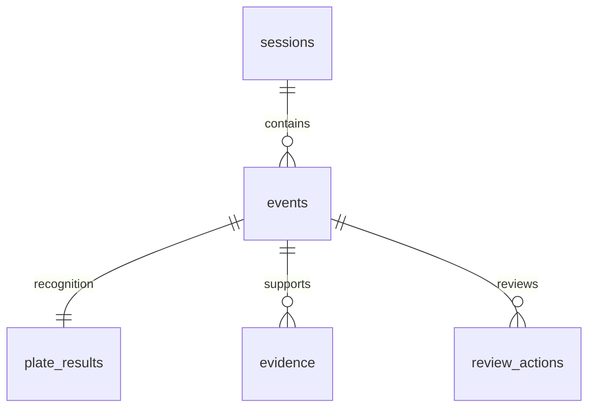

# Phase 6: persistent candidate records and evidence

Phase 6 adds local SQLite persistence without changing vehicle detection, SORT,
crossing geometry, signal checks or OCR rules. The original 319 tests remain;
the shared application-test fixture explicitly disables production storage.
All new storage tests use temporary databases and synthetic images.

Automatic detections remain **candidates**, even after OCR succeeds. A local
human review decision is separate from detection status and is not an automated
legal finding, fine or notification. Storage does not fix OCR accuracy.

## Modules and startup

- `database.py`: built-in `sqlite3` repository, validation, versioned schema,
  immutable crossing records, recognition updates, review, history and pagination.
- `violation_storage.py`: processing-session configuration, bounded retries,
  meaningful-change detection, evidence coordination and explicit retention.
- `evidence_manager.py`: small clean-frame/geometry ring, validated captures,
  exclusive writes, SHA-256 integrity checks and controlled file removal.
- `tools/export_violations.py`: filtered local JSON/CSV exports, privacy flags,
  formula-safe CSV cells and no-overwrite destinations.
- `main.py`: storage hooks before OCR, after recognition and during shutdown.

Imports and constructors open no SQLite connections and create no directories.
Only successful application-resource startup starts a session. Storage is enabled
by default at `data/violations.db`; evidence is **disabled by default**. No database
or evidence directory is served by Flask, and no history/review endpoints are added.
Startup checks storage settings before opening video. Configuration errors fail
startup explicitly; runtime database failures preserve in-memory processing and
are reported with safe error codes rather than sensitive SQL/record contents.

## Data model

Schema version is `PRAGMA user_version=1`. Initialization creates an empty schema
transactionally, checks expected columns, table/constraint/index definitions and
foreign keys, and rejects unknown or damaged schemas. There is no automatic
upgrade or replacement of an older/unrelated database. Back up and migrate
explicitly when a later schema version is introduced.

| Table | Purpose and constraints |
| --- | --- |
| `sessions` | Generated session UUID, safe source identifier, UTC start/end, processing status, frame dimensions, selected configuration/model snapshot |
| `events` | Existing Phase 2 UUID primary key; unique `(session_id, vehicle_track_id)`; original crossing/confirmation frames, timestamp provenance, UTC observation time, geometry and independent detection/review statuses |
| `plate_results` | One row per event; optional best and initial accepted automatic text, OCR score, format, recognition status and observation count |
| `evidence` | At most one record of each evidence kind per event; relative path, requested/actual frame, timestamp, dimensions, SHA-256 and saved/missing/failed status |
| `review_actions` | Append-only local review/correction history, operator identifier, old/new decision and manual plate, automatic result at review, note and UTC review time |



Child rows have foreign keys; event deletion cascades to recognition, evidence
metadata and review history. Image files are managed separately, never as SQLite
blobs. Indexes cover session/time, time, review/time, automatic plate/recognition
status and manual plate. Event ordering is deterministic: UTC detection time
descending, then event ID descending.

All SQL values are parameterized. Filter names, enums, IDs and numeric bounds are
validated before queries. Each operation owns and closes its connection in the
calling thread; write operations use short `BEGIN IMMEDIATE` transactions, with
commit/rollback covering all related SQL changes. There is no transaction held
during YOLO, OCR, image encoding or filesystem writes.

The default busy timeout is 200 ms. The existing SQLite rollback journal is
retained for this small single-machine prototype; WAL is not silently enabled
or used as an excuse to ignore contention. Concurrent writers can still lock.
This choice avoids changing the supplied Python/SQLite environment. See SQLite's
primary documentation on [transactions](https://www.sqlite.org/lang_transaction.html)
and [WAL tradeoffs](https://www.sqlite.org/wal.html). WAL can be evaluated in a
future controlled migration using a supported SQLite build. Do not delete an
active SQLite journal or copy a live database without a consistent backup.

## Session and candidate lifecycle

1. Resource startup assigns a new session UUID and records selected algorithm
   settings plus model filenames. Full local paths, credentials and arbitrary
   environment variables are not copied into the snapshot. In-project videos
   use relative identifiers, webcams use `webcam:N`, and external filenames are
   represented by a hash of their path.
2. Every processed frame supplies bounded geometry metadata; clean image copies
   are retained only when evidence is enabled.
3. A genuine red crossing creates the existing Phase 2 event UUID. Before plate
   inference/OCR, its candidate is submitted for a transactional database insert.
4. Persistent crossing fields remain immutable. Retrying the same event is
   idempotent. A different event UUID for the same session/track is rejected;
   the same numeric track in a different session is a separate event.
5. Meaningful recognition changes update the existing event's child row. Accepted
   automatic text cannot be replaced by a weaker result or reset by an empty
   observation. Initial accepted text remains available separately. Provisional
   guesses and raw OCR rows are not persisted.
6. EOF/error/shutdown flushes remaining recognition/evidence state within bounded
   attempts, records completed/failed/stopped session status and end time where
   possible, and clears live frame buffers. Pending retry state is explicitly
   stopped at shutdown; unsaved candidates are marked failed, not left queued.
   Stored records remain available through new connections and later processes.

`event['persistence']` records pending/persisted/failed state, retry count and a
safe error code in memory. An event saved successfully with a later evidence
metadata failure remains correctly marked saved, with that failure still visible.
It is never reported as persisted if its candidate write failed.

Phase 2 interpolates crossing time between advancing video-frame timestamps;
therefore persistent crossing `timestamp_kind` is **derived** when that value is
known, otherwise **unavailable**. Evidence frame PTS values are **measured** when
available. UTC `detected_at` is application observation time, not the original
recording date. UTC strings include timezone information and consistent precision.

The record keeps both original crossing frame and later confirmation frame.
The crossing-frame tracked bbox comes from bounded history; if it has expired,
the bbox is null rather than substituted from a different frame. Vehicle category
is currently null: the existing detector-to-SORT array discards class labels.
Storage does not invent a category or alter the detection adapter to obtain one.

Replaying a video in a new processing session produces separate events, preserving
both runs. Equal plate text never merges different vehicles or sessions. Existing
in-memory candidate lifetime and `/violations` current-session semantics remain
unchanged. Database rows are not automatically loaded into the public plate list.

## Failure handling and recovery

Session setup and individual dirty-event operations have finite retries: three
attempts by default, at least 30 processed frames apart after failure. At most two
dirty-event persistence batches are processed per frame; a batch can include an
event/recognition transaction and an evidence-metadata transaction. Pending-event
references are capped at 128. Requests awaiting a future frame or plate do not
consume the work budget. Buffers contain no unbounded image queue.

Safe diagnostics distinguish locked, unavailable, schema, constraint, conflict
and invalid-data failures. No raw registration, SQL parameter or full evidence
path is logged by these modules. Capture failures have separate bounded warnings.
An exhausted operation is not silently retried forever. An operator can repair
the underlying problem and explicitly call `storage.retry(event)` before another
`sync` in that same running session, preserving the event ID.

There is no secondary durable outbox: events that never reached a working
database remain in process memory and can be lost on termination. A capacity
limit or unavailable filesystem is explicit, not a durability guarantee. Final
shutdown may try remaining bounded work; it cannot guarantee writes on a broken
disk. A process killed before recording session end can leave that session marked
`running`; inspect it and call `finish_session(id, 'failed')` locally after verifying
it is no longer active. Startup does not assume other processes are dead.

SQLite rollback protects uncommitted SQL changes across abrupt process exit,
which is tested with a child process. Completed records survive reopening. A
read-only export cannot repair a hot rollback journal; initialize/recover the
database through the normal repository first if an interrupted process requires it.

## Evidence behavior and integrity

With `TRAFFIC_EVIDENCE_ENABLED=true`, a five-frame ring stores copies of clean
**resized processing frames**, not annotated display frames or full-resolution
source originals. This is explicitly recorded in session configuration and uses
the same 720 x 480 coordinate space as crossing geometry. At most 30 frames can
be configured; the entire video is never retained.

Default evidence requests one frame before the crossing, the recorded crossing
frame, one frame after it, and the crossing-frame vehicle crop. Optional annotated
copies draw candidate geometry on a separate clean-frame copy. Optional plate
evidence saves a clean crop only when accepted OCR enrichment makes one available.
It never substitutes a whole frame for a missing plate crop.

Unavailable pre/post/crossing frames and missing crops receive explicit metadata;
they are not reconstructed from predictions. A future post frame becomes missing
on shutdown if it was never observed. Delayed confirmation can exhaust a short
ring; this is recorded honestly. Image data must be nonempty uint8 BGR. Crops
require finite, correctly ordered, clipped positive-area coordinates.

Files use generated IDs only:

```text
evidence/<session_uuid>/<event_uuid>/<kind>-<actual_frame_index>.jpg
```

Database references are relative. The JPEG quality is 95. Writes use exclusive
creation, flush/fsync, and read-back SHA-256 verification. Identical retry files
can be reused; unrelated/different files are never overwritten. Frame/time,
dimensions, format kind, hash and capture outcome accompany each reference.
Path syntax, event ownership and resolved containment are checked, including
symlink/junction escapes. Missing/changed files can be detected without pretending
that an old `saved` capture status proves current availability:

```python
from database import Database
from evidence_manager import EvidenceManager
repository = Database('data/violations.db')
record = repository.get_event('EVENT_UUID_HEX')
manager = EvidenceManager('evidence')
availability = [manager.inspect(item) for item in record['evidence']]
```

Files and SQLite cannot share an atomic transaction. Candidate rows commit first;
files are written outside transactions, then metadata commits separately. Failed
metadata writes retain references in bounded in-memory retry state. A crash in
between can leave an orphan image; there is no automatic orphan deletion or
claim of an atomic evidence bundle. Inspect/reconcile such files locally before
removing them. Hashes detect changed bytes; they are not signatures or proof
against an attacker with access to both the database and images.

## Configuration

All settings are read at startup; restart to change them. Storage/evidence runtime
paths must resolve inside the repository's `data/`, `evidence/` or ignored
`outputs/` roots as appropriate. They cannot redirect into models, source, static
files or another directory. Standalone repository/evidence classes accept explicit
local paths so tests and local administrative programs can use temporary storage.

| Environment variable | Default |
| --- | --- |
| `TRAFFIC_STORAGE_ENABLED` | true |
| `TRAFFIC_DATABASE_PATH` | data/violations.db |
| `TRAFFIC_EVIDENCE_ENABLED` | false |
| `TRAFFIC_EVIDENCE_DIR` | evidence |
| `TRAFFIC_EVIDENCE_ANNOTATED` | false |
| `TRAFFIC_EVIDENCE_PLATES` | false |
| `TRAFFIC_EVIDENCE_BUFFER_FRAMES` | 5 (range 2-30) |
| `TRAFFIC_STORAGE_BUSY_TIMEOUT_MS` | 200 (range 0-5000) |
| `TRAFFIC_STORAGE_MAX_ATTEMPTS` | 3 |
| `TRAFFIC_STORAGE_RETRY_FRAMES` | 30 |
| `TRAFFIC_STORAGE_MAX_PENDING` | 128 |
| `TRAFFIC_STORAGE_OPERATIONS_PER_FRAME` | 2 |
| `TRAFFIC_RETENTION_DAYS` | 0 (disabled) |

Evidence cannot be enabled while storage is disabled. No automatic retention,
cleanup, owner lookup or upload runs at startup or during inference.

## Local history, review and correction

Use these interfaces only from a trusted local operator process with filesystem
access. An operator name is an audit identifier, not authentication. No new public
review/correction/export/history API is provided and no authentication system is
claimed. Protect the database/evidence/export directories with operating-system
permissions for the intended local account; Windows ACLs must be configured by
the deployment owner. These files are not encrypted by this phase.

```python
from database import Database
repository = Database('data/violations.db')
page = repository.history(session_id='SESSION_UUID_HEX',
                          review_status='pending', limit=50, offset=0)
repository.review_event('EVENT_UUID_HEX', 'rejected', actor='local-operator',
                        note='Insufficient evidence', corrected_plate='UP15AB1234')
```

Filters support session/event ID, timezone-aware `after`/`before`, review status,
recognition status, normalized effective plate, category and signal. Pages contain
at most 500 events. Missing values are null, not fabricated placeholders. Effective
plate text uses a manual correction when present, otherwise the automatic result.

Review transitions are pending -> approved/rejected, or approved/rejected ->
pending with a required reopening note. Change a completed decision by reopening
first. Same-status notes/corrections are recorded. Manual text must be normalized
ASCII letters/digits, at most 32 characters; empty text explicitly clears the
effective plate. Automatic results, initial accepted text and crossing metadata
remain intact. Every review action records its old/new values and timestamp.

## Controlled JSON/CSV exports

At least one explicit filter is required. Exports are paginated, never silently
dump the entire database. Plate strings, evidence paths and review notes/history
are absent by default and require independent flags. No source absolute paths or
arbitrary configuration are exported. Use unique destinations under `outputs/`:

```powershell
.\myvenv\Scripts\python.exe -B tools/export_violations.py `
  --session-id SESSION_UUID_HEX --limit 100 --output outputs/review-summary.json

.\myvenv\Scripts\python.exe -B tools/export_violations.py `
  --session-id SESSION_UUID_HEX --include-plates --include-evidence `
  --output outputs/authorized-local-review.csv
```

Other CLI filters mirror the repository with hyphenated names, e.g.
`--review-status`, `--recognition-status`, `--license-plate`, `--after`, `--before`.
The default filename uses a fresh UUID. Existing files, database paths, traversal
paths and destinations outside `outputs/` are refused. A missing database is not
created by export. Empty CSV results retain column headers; JSON contains an
empty records list and page metadata. CSV string cells with formula prefixes
`= + - @`, leading controls or whitespace/BOM-hidden formulas are prefixed with
an apostrophe. Missing CSV values are blank; missing JSON values are null.

Default fields include event/session IDs, UTC/video time and provenance, original
and confirmation frames, category, signal, crossing point, detection/review/
recognition status and purge-pending state. Optional plate fields include effective,
automatic and initial accepted text, OCR score and format. Evidence references
remain relative. Exports are local files; no external upload is implemented.

## Explicit retention and safe removal

`retention_days=0` disables policy selection. A positive day count enables an
internal selection/removal operation, not an automatic scheduler. Dry-run is the
default, active sessions are excluded, and each call is paginated. For example:

```python
from dataclasses import replace
# Use the existing configured storage object in a trusted local operator process.
storage.config = replace(storage.config, retention_days=30)
event_ids = storage.purge_expired(actor='local-operator')  # dry-run only
# After inspecting that selection, an operator may explicitly call:
# storage.purge_expired(actor='local-operator', dry_run=False)
```

Actual removal marks an event purge-pending first, checks each owned file/path
and hash, removes those files, then deletes the event and cascaded metadata.
Changed/unverified files block removal rather than being deleted. Missing files
are tolerated when resuming an interrupted purge. Any failure leaves a visible
purge-pending row for a later explicit retry; no fully purged result is claimed.
Empty generated UUID directories may remain. Session configuration records remain;
they contain no stored plate/evidence image data. No recursive directory deletion
is performed. Purging removes review history too; take an authorized consistent
backup beforehand if that history must be retained separately.

## Verification and measured limits

Run the complete suite:

```powershell
.\myvenv\Scripts\python.exe -B -m unittest discover -s tests -v
```

New tests cover schema/version/index checks, duplicate/immutable events, distinct
sessions, transactions and simulated disk-full rollback, lock handling, thread-owned
connections, abrupt process termination, review history and transitions, filtered
pagination, bounded retries and work capacity, meaningful OCR updates, pre/post
evidence availability, clean-frame integrity, safe names and paths, write failures,
retention dry runs/resumption, export privacy, formula injection and Flask semantics.
Production databases and evidence are never used by automated tests.

The real-model smoke uses separate ignored test databases/evidence directories,
existing cached weights, blocked network connections, a single stream consumer,
and the same first 60 sample-video frames. It compares Phase 5, Phase 6 storage
only, and Phase 6 with clean/annotated evidence. It independently re-decodes source
frames and compares saved clean JPEG/crop hashes and timestamp metadata. It also
starts a fresh application session against the saved database and verifies old
records survive while the public plate list starts empty. Reports are local and
contain counts/configuration, not invented plate text.

The complete suite passes **412 tests: all 319 previous cases plus 93 new cases**,
with zero failures. Previous assertions remain intact; the only previous test-file
change is the explicit production-storage opt-out in the shared fixture.

The quiet single-viewer comparison used CPU, 8 logical processors/7 torch threads,
Python 3.8.10, SQLite 3.35.5, torch 2.4.1+cu121, Ultralytics 8.3.217, OpenCV 4.12.0,
and NumPy 1.24.1, default nano .25/640/.7 and unchanged SORT/OCR settings:

| Measurement, same first 60 frames | Phase 5 | Phase 6 storage | Phase 6 + evidence |
| --- | ---: | ---: | ---: |
| Accepted vehicle detections | 1,304 | 1,304 | 1,304 |
| Candidates / persisted candidates | 2 / n/a | 2 / 2 | 2 / 2 |
| Plate-model / OCR calls | 21 / 6 | 21 / 6 | 21 / 6 |
| Accepted plate strings | 0 | 0 | 0 |
| Processing FPS | 2.642 | 3.225 | 3.261 |
| Mean candidate repository write ms | n/a | 5.965 | 5.483 |
| Mean recognition-state update ms | n/a | 4.361 | 4.753 |
| Saved evidence images | 0 | 0 | 10 |
| Mean / P95 evidence capture ms | n/a | n/a | 7.605 / 10.248 |
| Total evidence capture ms | n/a | n/a | 76.050 |

The 10 images are two sets of pre/crossing/post/vehicle/annotated evidence. Eight
clean frames/crops matched independently re-decoded JPEG bytes exactly; all ten
passed file-hash integrity checks, and measured timestamps matched source-frame
PTS values. Fresh application startup created a different session and retained
the original two records; `/violations` began empty. Actual OCR still accepted
zero plates; accepted enrichment is verified separately with mocked/synthetic
unit data, never by adding placeholder plates to these real-video records.

These are single sequential runs, not proof of a throughput improvement. Model
timings vary, and the small repository sample has only two candidate writes per
mode. An initial comparison overlapped tests and is retained only as a preliminary
diagnostic. FPS includes processing/MJPEG generation but excludes initialization,
warmup, HTTP/browser delivery, shutdown and independent evidence verification.

A separate 100-record synthetic temporary-database benchmark measured whole
repository calls, including connection/transaction/close, with no images/plates:

| Operation | Mean ms | Median ms | P95 ms |
| --- | ---: | ---: | ---: |
| Candidate insert | 5.997 | 5.418 | 9.429 |
| Idempotent replay | 0.546 | 0.453 | 1.153 |
| Recognition-state update | 3.388 | 3.166 | 4.742 |

The temporary benchmark database was removed after use. This hot local-filesystem
microbenchmark is not a production latency guarantee. Reports and controlled
smoke artifacts are ignored and separate from production storage:

```text
outputs/phase6_storage_smoke_final.json
outputs/phase6_repository_benchmark.json
outputs/phase6-smoke-98e68cc6c58f47268019da707876003a/
```

Remaining limits: synchronous SQLite/filesystem work adds bounded latency;
locked/broken disks can still prevent durability; evidence is not an atomic or
signed bundle; OS permissions and encryption are deployment responsibilities;
there is no public authenticated review UI or multi-client streaming redesign.
Physical hardware power loss, hostile concurrent filesystem replacement, long
production retention runs and encrypted backups are not validated. OCR in this
video remains unreadable; no OCR accuracy improvement is attributed to storage.
